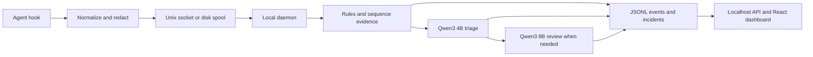

# Architecture and judgment

A daemon is a background process. Here it consumes hook events, tracks agent/session history and queues local model assessments. Hooks are small commands invoked by the agent at its native lifecycle events. They log evidence; they do not approve, reject or interrupt tool calls. A configured hook is not proof it has fired.

Capture and inference are separate. If Ollama is slow or unavailable, evidence still persists. Tool-call IDs join actions to delayed outputs. Assessing an action again with its output updates that action rather than adding a second unique action. Unknown tools remain visible and lower the reported coverage.

Rules identify structural effects and sequences: credentials sent to a network destination, destructive operations, changes to oversight, remote execution, privilege changes, resource exposure, dependency changes and instructions embedded in untrusted output. Broad permissions, an outside-workspace path or a network command alone need context.

The cascade settles clear low/high rule evidence first. Actions needing interpretation use Qwen3 4B triage; uncertainty or sufficient score escalates to Qwen3 8B. Live incident/notification thresholds remain 5/8. Trusted monitoring policy and the JSON response contract occupy the system message; serialized task/action/output evidence occupies the user message. Embedded instructions are evidence to evaluate.

Judgments report a risk score, concise evidence, authorization, affected boundary, recoverability, category and self-reported confidence. Unknown user intent stays unclear. A quoted command in a document differs from executing it; editing executable code or monitoring configuration can itself have an effect. Email redaction indicates personal data, not automatically a credential. It still requires interpretation where rules cannot settle the action.

Requests require completed structured responses. A temporary HTTP 500/502/503/504 gets one retry with a short backoff within the original time budget. Invalid JSON, truncation and timeouts stay failures. Failed stages and actual retries are counted separately. Available rule evidence is retained, and unresolved assessments are labelled incomplete.

Claude Code is the primary verified capture path. Codex is supported through its adapter and opt-in hook installation; installed agent versions and hook approvals affect native coverage. The monitor does not capture general ChatGPT web conversations or every VS Code extension automatically. Check `monitor doctor --json` and confirm a fresh agent action in the UI after enabling an integration.

## Research rationale

The explicit criteria and response fields adapt the evaluation approach in [G-Eval](https://arxiv.org/abs/2303.16634), while [Ollama's structured-output documentation](https://docs.ollama.com/capabilities/structured-outputs) motivates supplying the schema in both the API format and trusted prompt. A schema enforces shape; it does not establish correct semantics. The bounded retry follows [retry/backoff guidance](https://docs.aws.amazon.com/prescriptive-guidance/latest/cloud-design-patterns/retry-backoff.html); retrying a judgment does not execute the observed action.

Adversarial scenarios, contextual attacks and separate miss/false-alarm reporting draw on [AI Control](https://arxiv.org/abs/2312.06942), [AgentDojo](https://arxiv.org/abs/2406.13352), and [AutoMonitor-Bench](https://arxiv.org/abs/2601.05752). The supplied synthetic dataset and local evaluation are adaptations, not reproductions of those benchmarks. Models may still misread intent or adversarial evidence.
